<a href="https://github.com/Pravallika2789">GitHub</a> &nbsp;·&nbsp; <a href="https://www.linkedin.com/in/reddy-pravallika-812723325">LinkedIn</a> &nbsp;·&nbsp; <a href="mailto:r.pravallika2789@gmail.com">Email</a>

